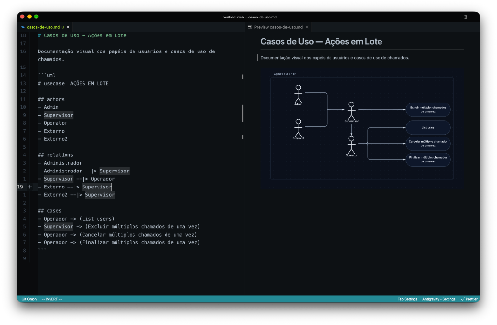
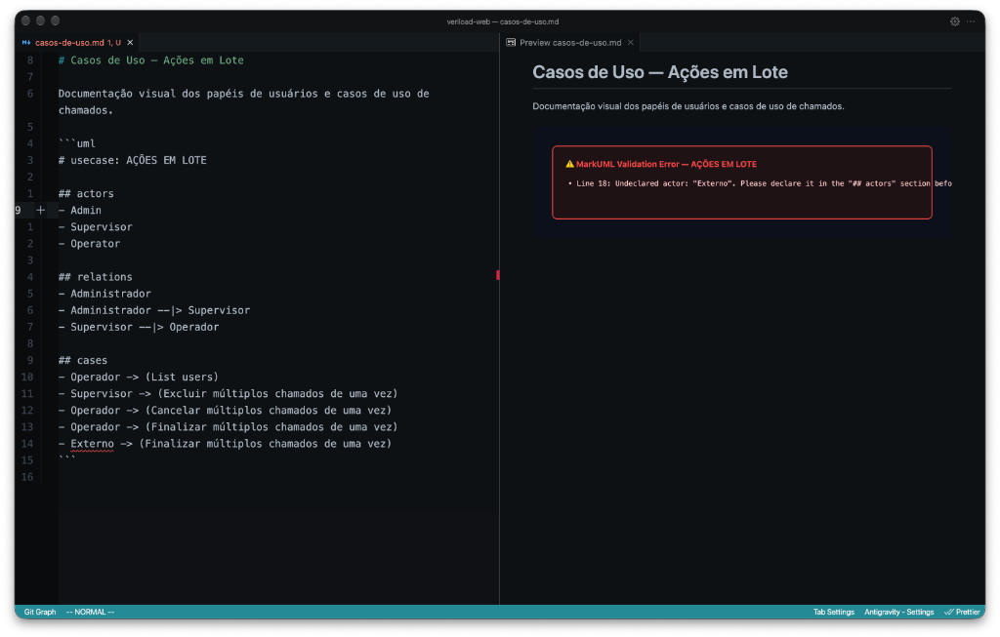

# MarkUML Preview for VS Code & Antigravity

[](https://marketplace.visualstudio.com/items?itemName=LeandroGCruzP.markuml-vscode)
[](https://opensource.org/licenses/MIT)

**MarkUML** is a lightweight, zero-dependency VS Code and Antigravity IDE extension that renders clean, modern, publication-ready **UML Use Case Diagrams** directly inside your Markdown (`.md`) preview and standalone `.markuml` / `.uml` files.

---

## 📸 Preview



---

## ✨ Features

- ⚡ **Instant Live Preview**: Seamlessly integrates with the native Markdown preview (`Cmd+Shift+V` / `Cmd+K V`).
- 🎨 **Modern Dark & Light Theme**: Elegant SVG styling with classic stick-figure actors, dot-grid background, and soft rounded use case pills.
- 📐 **100% Orthogonal Routing**: Guaranteed clean 90° stepped connector lines with rounded elbows — zero diagonal line clutter or messy crossings.
- 🔍 **Real-time Diagnostics**: In-editor linting with red squiggly warnings if an actor is referenced in `cases` or `relations` without prior declaration under `## actors`.
- 🌐 **Built-in i18n**: Diagnostic messages adapt automatically to your IDE language (English and Portuguese supported).
- 🔒 **Zero Dependencies & Privacy-First**: 100% local client-side rendering. No external server calls, no telemetry, no PlantUML server needed.

---

## 🚀 How to Use

### 1. In Any Markdown File (`.md`)

Wrap your diagram in a ````uml```` or ````markuml```` code block:

````markdown
# Sistema de Chamados

Documentação dos papéis de usuários e casos de uso do sistema.

```uml
# usecase: Gestão de Chamados

## actors
- Admin
- Supervisor
- Operador

## relations
- Admin --|> Supervisor
- Supervisor --|> Operador

## cases
- Operador -> (Listar chamados)
- Operador -> (Finalizar chamado)
- Supervisor -> (Cancelar múltiplos chamados em lote)
- Admin -> (Gerenciar permissões do sistema)
```
````

Then open the Markdown Preview (`Cmd+Shift+V` on macOS or `Ctrl+Shift+V` on Windows/Linux).

---

### 2. In Standalone Files (`.markuml` / `.uml`)

Create a file named `diagram.markuml`:

```uml
# usecase: Ações em Lote

## actors
- Admin
- Supervisor
- Operador

## relations
- Admin --|> Supervisor
- Supervisor --|> Operador

## cases
- Operador -> (List users)
- Supervisor -> (Excluir múltiplos chamados de uma vez)
- Operador -> (Cancelar múltiplos chamados de uma vez)
- Operador -> (Finalizar múltiplos chamados de uma vez)
```

Click the **Preview** button in the top-right editor title bar or press `Cmd+K V` (`Ctrl+K V` on Windows/Linux).

---

## 🔍 In-Editor Syntax Validation

MarkUML validates your actors as you type. If you reference an actor that has not been declared under `## actors`, the editor displays an inline diagnostic warning:



---

## 📖 Syntax Reference

| Section | Description | Syntax Example |
| :--- | :--- | :--- |
| **Header** | Defines diagram type and boundary title | `# usecase: Nome do Sistema` |
| **Actors** | Declares all valid system actors | `## actors`<br>`- NomeDoAtor` |
| **Relations** | Generalization / inheritance between actors | `## relations`<br>`- Admin --\|> Supervisor` |
| **Cases** | Connects an actor to a use case | `## cases`<br>`- Operador -> (Título do Caso)` |

---

## ⌨️ Keyboard Shortcuts

| Shortcut | Action |
| :--- | :--- |
| `Cmd+Shift+V` / `Ctrl+Shift+V` | Open Markdown Preview |
| `Cmd+K V` / `Ctrl+K V` | Open MarkUML Side Preview |

---

## 📄 License

This project is licensed under the [MIT License](LICENSE).
